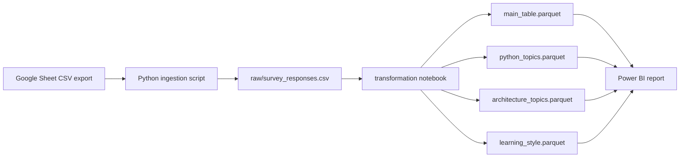

# Survey

Survey response ETL and Power BI analysis for a data engineering class.

 

## What this project does

This project collects feedback from a class survey and prepares it for analysis. The questions cover learners' Python experience and backgrounds, preferred class direction, Python and architecture topics, learning styles, expectations, pace, difficulty, and the balance between theory and practice.

The local sample contains **19 responses**. A Python ingestion script reads the survey's Google Sheet as CSV and saves a raw copy. A transformation notebook creates one respondent-level table and three tables that expand multi-select answers into individual rows. Those four tables are saved as Parquet files and used by a Power BI report.

There is no web application, API, database, or automated deployment in this project.

## Workflow at a glance



The included `raw/survey_responses.csv` and `target/*.parquet` files are snapshots. Running the ingestion step again can replace the raw CSV with newer Google Sheet responses.

## Project files

```text
Survey/
├── pipeline/
│   ├── raw_to_stg_python.py       # Google Sheet CSV -> raw CSV
│   └── raw_to_stg-.ipynb          # notebook version of ingestion
├── transformation/
│   └── transformation.ipynb       # raw CSV -> four Parquet tables
├── raw/
│   └── survey_responses.csv       # current raw survey snapshot
├── target/
│   ├── main_table.parquet
│   ├── python_topics.parquet
│   ├── architecture_topics.parquet
│   └── learning_style.parquet
├── Power_bi_Dashbord/
│   └── Survey.pbix                # Power BI report
├── error/
│   └── survey_responses.csv       # existing copy for error investigation
└── archive/                       # reserved for older raw files
```

The `pipeline/raw_to_stg_python.py` notes describe `archive/` as a future stage. The current script does **not** move successful raw files into `archive/`. The file presently in `error/` has the same contents as the checked-in raw snapshot; it is not evidence of a current failed run.

## Tools and dependencies

| Tool | Used for | Verified local version |
| --- | --- | --- |
| Python | Running the ingestion script and notebooks | 3.10.8 |
| pandas | Reading CSV, splitting and reshaping responses | 2.3.3 |
| pandasql | SQL queries inside the transformation notebook | 0.7.3 |
| fastparquet | Writing and reading Parquet | 2026.9.0 |
| JupyterLab | Running the notebooks | 4.6.4 in the current local environment |
| Power BI Desktop | Opening and refreshing `Survey.pbix` | Version not recorded |

These are versions found in the local environment, not version pins. This project currently has no dependency lockfile or automated test suite.

## Step-by-step: run the project

The existing code uses the absolute project path `F:\Big Data\Survey` for output files. The commands below assume Windows and that the project remains at that path. If you move the folder, update the `project_folder` value in `pipeline/raw_to_stg_python.py` and the four output paths in the final cell of `transformation/transformation.ipynb` before running them.

### 1. Prepare Python

Open PowerShell in the project folder:

```powershell
Set-Location 'F:\Big Data\Survey'
py -3.10 -m venv .venv
.\.venv\Scripts\Activate.ps1
python -m pip install pandas pandasql fastparquet jupyterlab
```

If you already have the local `.venv`, activate it instead of creating a new one. An internet connection is needed to install packages and to fetch the Google Sheet. Power BI Desktop is needed only for the dashboard.

### 2. Review the source data

The survey is read from the first worksheet's CSV export URL embedded in `pipeline/raw_to_stg_python.py`. The included snapshot has **11 columns**. The script renames those columns to:

```text
response_time, python_level, background, class_direction,
python_topics, architecture_topics, learning_style,
expectations_rating, pace, difficulty, theory_practice_balance
```

The existing `raw/survey_responses.csv` already contains 19 responses, so you can start at step 4 to reproduce the current transformation without fetching the sheet.

### 3. Ingest the latest sheet responses (optional)

```powershell
python pipeline\raw_to_stg_python.py
```

This script reads the fixed Google Sheet CSV URL with pandas, checks that it has 11 columns, applies the field names above, and writes `raw/survey_responses.csv` with a header and without a pandas index. It prints the saved path. The script creates `raw/` and `error/` if necessary. On a save error it tries to move an existing raw CSV into `error/` and prints the error; this behavior can move a previous good raw file, so keep a copy before rerunning against a changed source.

`pipeline/raw_to_stg-.ipynb` is an earlier notebook walkthrough of the ingestion step. Its final cell writes `index=True, header=False`, which is a different CSV shape from the Python script and from what the transformation notebook expects. **Use the Python script** for the current end-to-end flow.

### 4. Transform the raw responses

The transformation notebook reads `../raw/survey_responses.csv` relative to its own folder. Start Jupyter from `transformation/` so that relative path resolves correctly:

```powershell
Set-Location 'F:\Big Data\Survey\transformation'
jupyter lab
```

Open `transformation.ipynb` and choose **Run All**. The notebook:

1. Loads the raw CSV into a pandas DataFrame.
2. Uses `pandasql` to add a sequential `survey_key` and select the respondent-level fields.
3. Splits the three comma-separated multi-select fields and expands each selection into its own row with pandas `explode`.
4. Writes four Parquet files into `F:\Big Data\Survey\target` with `fastparquet`.

The notebook assigns and selects `survey_key` in two SQL queries. Its `ORDER BY response_time` sorts the stored timestamp **text**, so the keys should not be treated as stable identifiers across refreshed or edited source data. The simple comma split also divides commas that occur inside answer labels such as `Core Python (functions, OOP, error handling)`; the resulting topic row counts therefore describe the current notebook output, not a fully cleaned list of choices.

### 5. Inspect the output tables

For the included 19-response snapshot, the existing Parquet files have these shapes:

| File | Rows | Columns | Purpose |
| --- | ---: | --- | --- |
| `target/main_table.parquet` | 19 | `survey_key` plus all 11 survey fields | One row per response |
| `target/python_topics.parquet` | 94 | `survey_key`, `python_topics` | One row per split Python-topic fragment |
| `target/architecture_topics.parquet` | 114 | `survey_key`, `architecture_topics` | One row per split architecture-topic fragment |
| `target/learning_style.parquet` | 60 | `survey_key`, `learning_style` | One row per learning-style selection |

The `survey_key` field is used to relate the three expanded tables to `main_table`. One response in the sample has a blank `background` value. The notebook's prose says there are 59 learning-style selections, while the saved Parquet file contains **60**; the table count above reflects the actual file.

You can check the tables with pandas:

```powershell
Set-Location 'F:\Big Data\Survey'
python -c "import pandas as pd; print(pd.read_parquet('target/main_table.parquet').head())"
```

### 6. Open the dashboard

Open `Power_bi_Dashbord/Survey.pbix` in Power BI Desktop. It contains one page with nine visuals for survey background, preferred topics and learning styles, class direction, expectations, difficulty, and theory/practice balance. The report stores imported data; running the notebook does not automatically update the open report. Update its local Parquet data-source paths if necessary, then use **Refresh** in Power BI Desktop.

The report file was inspected structurally, but its rendered page and refresh were not verified in Power BI Desktop. The architecture-topics chart currently uses `Max of survey_key` as its value, rather than a response count, so its height should not be interpreted as topic popularity until that measure is corrected in Power BI Desktop.

## Current limitations

- The script and final notebook cell contain fixed `F:\Big Data\Survey` paths.
- The ingestion notebook exports a CSV shape that differs from the Python script.
- The transformation notebook's text timestamp ordering and comma splitting can produce misleading keys or topic categories.
- There is no automated test suite, dependency lockfile, or scheduled pipeline.
- The Power BI report needs a manual refresh and path review after moving the project.
- No dashboard screenshot is included.

## Author

[usman611b on GitHub](https://github.com/usman611b) · [Usman Ali on LinkedIn](https://www.linkedin.com/in/usman-ali-b44358368/)

## License

No license file is present. Contact the author before reusing or redistributing the code or survey data.
